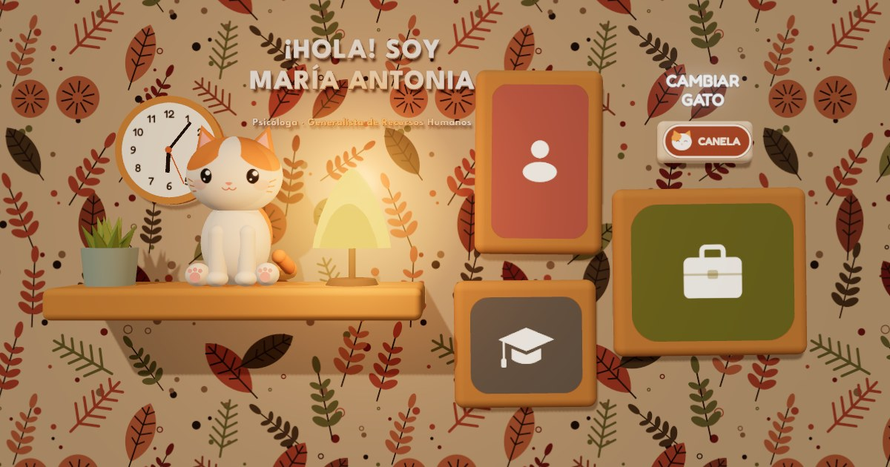

# Portafolio interactivo de María Antonia Chica

Portafolio web en 3D de María Antonia Chica Quintero, psicóloga y generalista de Recursos Humanos. En lugar de una página tradicional, el visitante recorre una pequeña oficina: una pared con cuadros, un escritorio y el piso bajo el escritorio. Cada objeto abre una sección del perfil.

**Sitio en línea:** https://portafolio-interactivo-psicologa-or.vercel.app



## Qué se puede hacer en el sitio

- **Recorrer la oficina con el scroll.** La cámara baja por tres paradas: la pared, el escritorio y el piso.
- **Abrir las secciones** haciendo clic en los objetos o desde el menú:

  | Objeto | Sección |
  | --- | --- |
  | Cuadro con la persona | Sobre mí |
  | Cuadro con el maletín | Experiencia |
  | Cuadro con el birrete | Formación |
  | Monitor izquierdo | Proyectos |
  | Sobre en el piso | Contacto |

- **Cambiar de idioma** entre español e inglés desde el menú. El sitio recuerda la elección y, en la primera visita, usa inglés si el navegador está en inglés.
- **Jugar con la escena.** El gato camina y salta de la repisa al escritorio y a su cama según el scroll, y se puede cambiar entre Bonny, Holly y Molly. La lámpara y la luz de noche se apagan y encienden con un clic.
- **Escuchar música de fondo** con el botón de sonido.
- **Enviar un mensaje** desde el formulario de contacto.

## Tecnologías

- [Vite](https://vitejs.dev/) y JavaScript sin framework.
- [Three.js](https://threejs.org/) para la escena 3D.
- [GSAP](https://gsap.com/) para las animaciones.
- [FormSubmit](https://formsubmit.co/) para el formulario de contacto, sin servidor propio.

La escena no usa modelos ni imágenes externas: la geometría se construye por código y las texturas (papel tapiz, letrero, pantallas, cara del gato) se dibujan en canvas.

## Cómo ejecutarlo

Requiere [Node.js](https://nodejs.org/) 18 o superior.

```bash
npm install
npm run dev      # servidor local en http://localhost:5173
npm run build    # compila el sitio en dist/
npm run preview  # sirve la versión compilada
```

## Estructura

```
index.html              Página, paneles de contenido y etiquetas de SEO
vite.config.js          Dominio del sitio, sitemap.xml y robots.txt
public/                 Foto, imagen de vista previa, favicon, música e imágenes de proyectos
src/
  main.js               Paneles, menú, idioma, música y formulario
  style.css             Estilos de la interfaz
  audio.js              Música generada y sonido de interruptor
  i18n.js               Cambio de idioma
  i18n/en.js            Traducción al inglés
  experience/
    Experience.js       Cámara, scroll, clics y bucle de render
    Room.js             Toda la escena: pared, escritorio, piso y gato
    textures.js         Texturas dibujadas en canvas
```

## Cómo editar el contenido

- **Textos del perfil:** están en español en `index.html`. Al cambiar un texto, actualiza también su traducción en `src/i18n/en.js`; la clave de cada traducción es el texto en español tal como aparece en la página. Un texto sin traducción se muestra en español en la versión en inglés.
- **Proyectos:** cada tarjeta es un `<article class="project-item">` en `index.html`. Las imágenes van en `public/imagenes_proyectos/`, en formato 16:9.
- **Música:** el botón de sonido reproduce `public/musica.mp3`. Si ese archivo no existe, suena una música generada por el navegador.
- **Dominio:** la dirección pública está en `vite.config.js` (`SITE_URL`). De ahí salen la imagen de vista previa para redes, la URL canónica, los datos estructurados, el sitemap y `robots.txt`. Si el sitio cambia de dominio, se cambia solo ahí.
- **Formulario de contacto:** el correo de destino está en `src/main.js` (`CONTACT_EMAIL`). FormSubmit pide confirmar ese correo una vez, con un enlace que envía al primer mensaje.

## Despliegue

El sitio está publicado en Vercel y se actualiza con cada cambio en la rama `main`. La imagen que aparece al compartir el enlace es `public/og-image.jpg` (1200 × 630).
